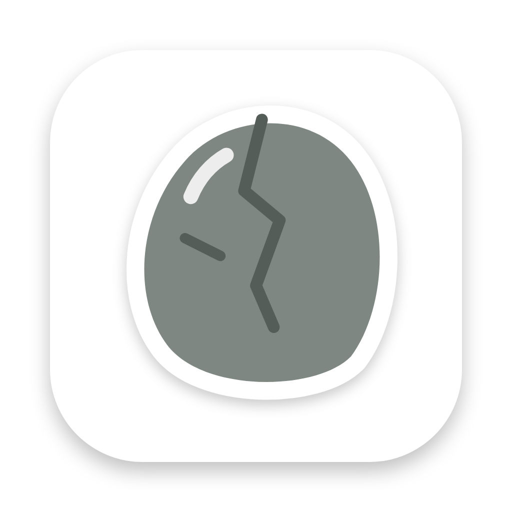

<p align="center"></p>

<h1 align="center">Sísifo</h1>

<p align="center">Teus grupos de trabalho do WhatsApp, lidos e resumidos. O que pedem pra ti vira demanda, o resto tu só fica sabendo.</p>

---

O Sísifo é um app de Mac que lê o teu WhatsApp e usa o Claude (da tua própria assinatura, pelo Claude Code) pra:

- **Tirar demandas** das conversas: quem pediu, o quê, pra quando, se já foi respondida por alguém da equipe.
- **Resumir as não lidas** em uma linha e sugerir resposta no teu jeito de escrever.
- **Separar Trabalho de Privado**: grupos onde a tua equipe fala viram Trabalho.
- **Responder sem abrir o WhatsApp**, com chat de verdade dentro do app.
- **Mandar uma demanda pro Claude Code** com um clique, já com o contexto da conversa.

Tudo roda no teu Mac. As mensagens ficam em `~/Library/Application Support/Sisifo` e só vão pro Claude na hora de resumir.

## Instalar

1. Baixa o `Sisifo.dmg` na página de [Releases](../../releases) e arrasta o app pra Aplicativos.
2. Na primeira vez, clica com o botão direito no app e escolhe **Abrir** (o app ainda não é assinado pela Apple).
3. Segue as telas: conecta o Claude, escaneia o QR do WhatsApp, marca tua equipe.

**Precisa de:** macOS 26 num Mac com Apple Silicon e o [Claude Code](https://claude.com/claude-code) instalado.

## Aviso sobre o WhatsApp

A conexão usa o [Baileys](https://github.com/WhiskeySockets/Baileys), que funciona como o WhatsApp Web mas **não é oficial**. O WhatsApp pode limitar ou banir contas que usam apps assim. Usa por tua conta e risco, de preferência com moderação.

## Como funciona

```
Sisifo.app
├── app Swift (janela, barra de menus, primeira abertura)
├── node embutido
├── bridge/          ponte do WhatsApp (Baileys) → SQLite local, 127.0.0.1:47851
├── server/          demandas e não lidas, chama `claude -p`, 127.0.0.1:47852
└── server-privado/  conversas e envio, 127.0.0.1:47853
```

Nada escuta fora do `127.0.0.1`. A ponte pede um token salvo só no teu Mac.

## Montar do código

```sh
git clone <este repositório> && cd sisifo
./build.sh            # build/Sisifo.app
./build.sh --install  # copia pra /Applications
./build.sh --dmg      # build/Sisifo.dmg
```

Precisa de Xcode (Swift 6) e Node 22.5+ (o Node é copiado pra dentro do app).

## Licença

MIT. Veja [LICENSE](LICENSE).
